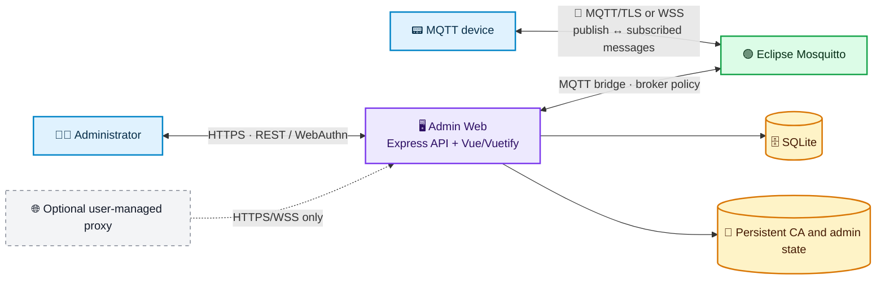
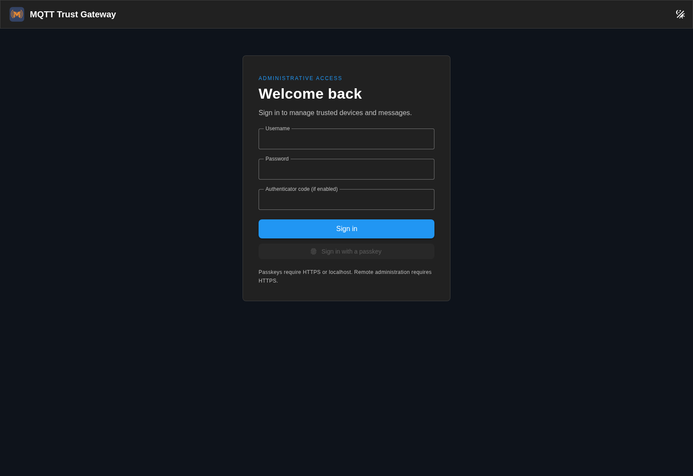
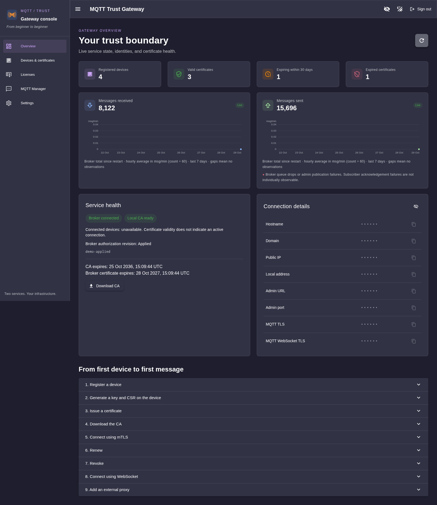
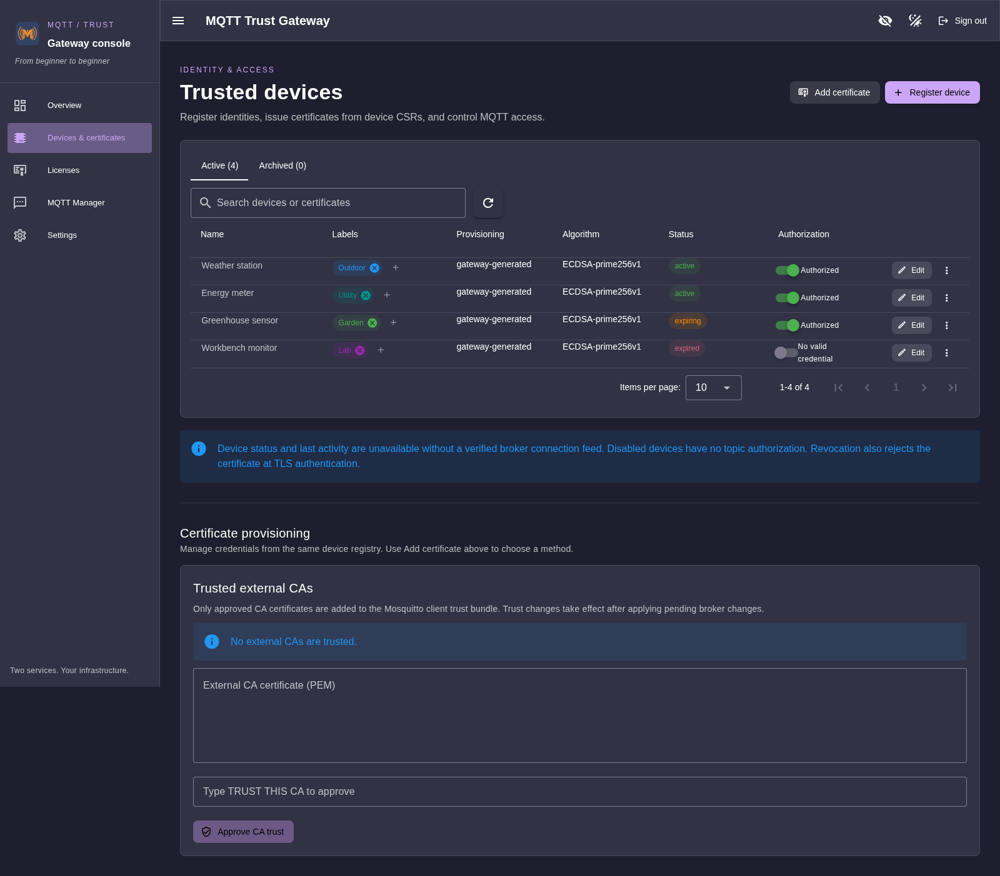
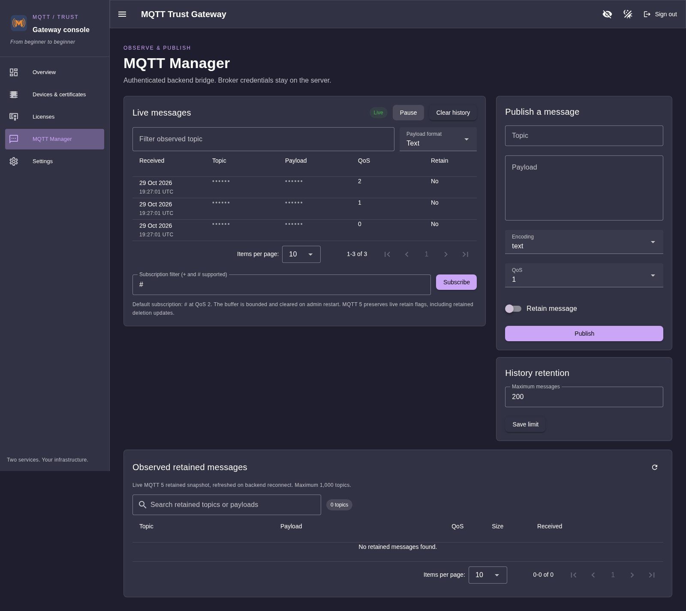
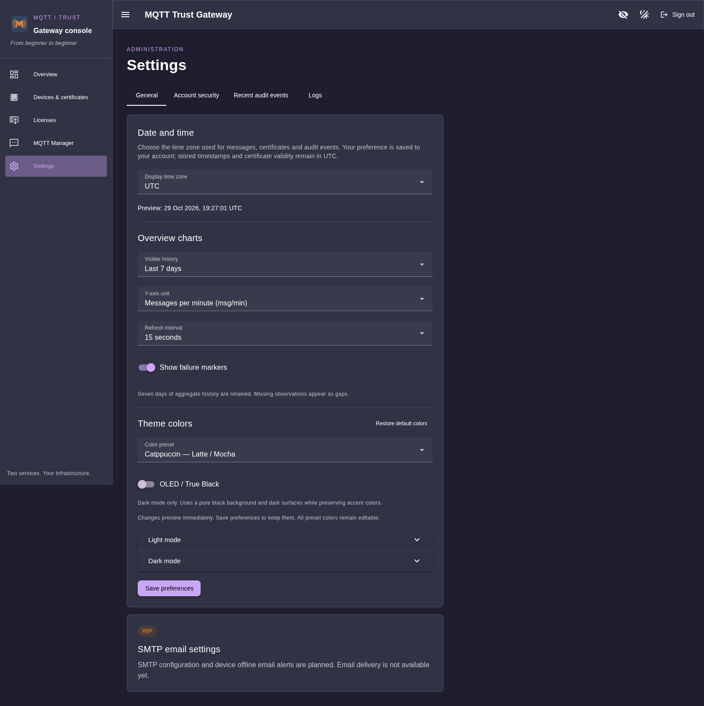
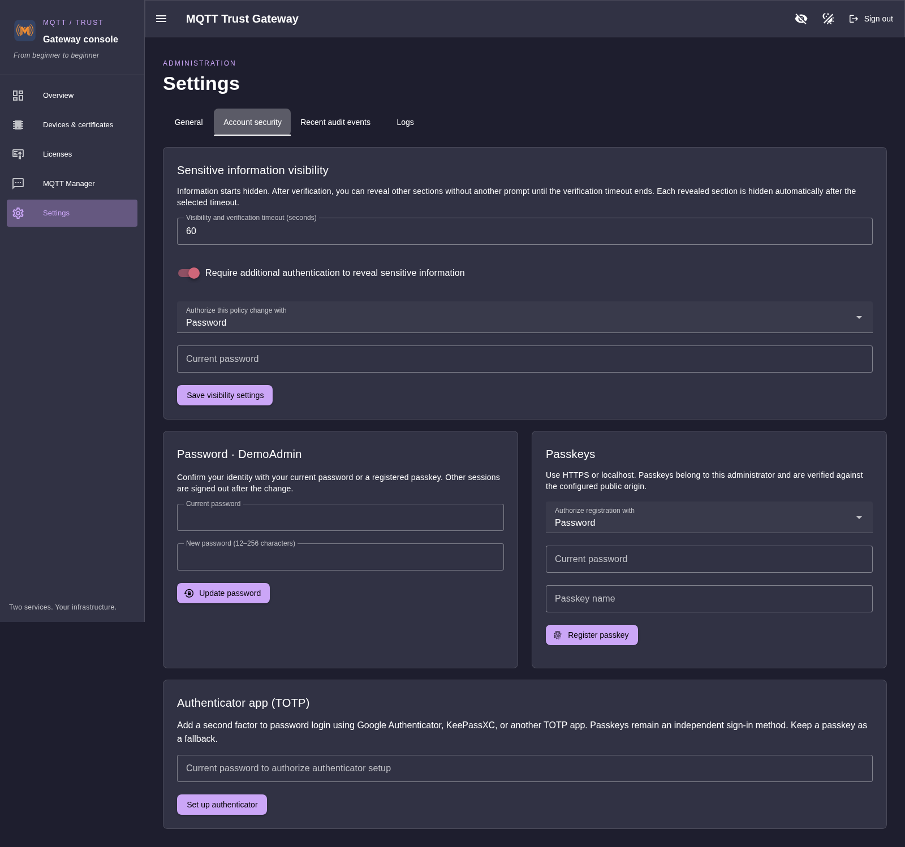

# MQTT Trust Gateway

**Version 1.0.0** · [Apache-2.0](LICENSE) · [Release notes](docs/releases/1.0.0.md)

A lightweight, self-hosted MQTT gateway for trusted device identities. It combines Eclipse Mosquitto with a Vue 3 / Vuetify 3 admin console and a local certificate authority.

- 🔒 **Secure device access:** individual X.509 certificates and mandatory MQTT mTLS.
- 🧭 **Simple operations:** two rootless Podman Quadlets; no step-ca, integrated proxy, Certbot, Docker Compose, Redis, or external database.
- 🖥️ **One admin container:** Node/Express API serves the compiled Vue interface.
- 💾 **Persistent state:** SQLite stores identities, certificate history, settings, and audit records.
- 🏠 **Works locally:** no public domain or reverse proxy required.

> [!WARNING]
> **Existing installation?** Read the [migration guide](docs/migration.md) first. The installer does not replace an existing device CA. Converting a legacy step-ca hierarchy requires offline review; it is not automatic.

## ✨ Features

- 🪪 Four certificate enrollment methods: sign a device CSR, create a CSR for an external CA, generate a complete device credential bundle, or import an existing certificate.
- 🧰 Central device and certificate lifecycle: renew, revoke, trust external CAs, archive, restore, and permanently delete identities.
- 🛡️ Admin security: Argon2id passwords, TOTP, WebAuthn passkeys, expiring sessions, rate limiting, and step-up verification for sensitive data.
- 📡 MQTT tools: live subscriptions, wildcard filters, pause/resume, retained-message management, and publishing at QoS 0/1/2.
- 📊 Overview: broker and CA status, certificate counts, and seven days of hourly message traffic.
- 🎨 Responsive UI: dark/light mode, editable palettes, 14 theme presets, and OLED mode.
- 🧩 Optional integration: user-managed HTTPS proxy and raw TCP forwarding; gateway services do not install or manage a proxy.
- 🧾 [Apache-2.0 license](LICENSE), attribution in [NOTICE](NOTICE), and third-party license inventory in [THIRD_PARTY_LICENSES.json](THIRD_PARTY_LICENSES.json).

## 🚧 Work in progress

- ✉️ **SMTP settings:** configure an outbound mail server and sender identity from **Settings → General**.
- 🧩 **Per-device rules:** add a dedicated **Rules** tab in the device editor for MQTT access policies.
- 🩺 **Device health checks:** add a per-device **Health Check** tab and define how devices report status.

## 🏗️ Architecture



- **Containers:** `mqtt-broker` and `mqtt-admin`, on the shared rootless `mqtt-gateway` network.
- **Two-way MQTT:** devices publish to the broker and receive subscribed messages from it over either transport.
- **Mutual TLS identity checks:** the device uses `server-ca.crt` to validate the broker's certificate chain and hostname/SAN. It presents `device.crt` and proves possession of `device.key`; Mosquitto validates that client certificate against its trusted client CA and CRL, then applies the device ACL. `client-ca.crt` and `server-ca.crt` have different roles and may be different CAs.
- **Trust boundary:** Mosquitto performs these checks directly; an optional raw TCP proxy must forward MQTT TLS bytes unchanged.
- **Storage:** admin state and CA material are not mounted into the broker container.
- **Browser limitation:** browser JavaScript cannot directly select a client certificate for native WebSocket TLS. The console uses its protected backend MQTT bridge instead.

## 📸 Screenshots

Captured with Chromium from the real admin UI. Device names are illustrative; infrastructure values, certificate identifiers, topics, and payloads are masked. No production account or private key is shown.

| Login | Overview |
| --- | --- |
|  |  |
| **Devices & certificates** | **MQTT Manager** |
|  |  |
| **General settings** | **Account security** |
|  |  |

## 🚀 Install (rootless Podman)

**Requirements:** Linux, rootless Podman with Quadlet support (Podman 5+ recommended), user systemd manager, subordinate UID/GID ranges, and a rootless network backend. Bun is only needed for development; image builds use Bun internally.

```sh
cp gateway.env.example gateway.env
# Optional: edit gateway.env. No domain or external proxy is required.
./gateway install
./gateway status
./gateway logs
```

- The installer validates configuration, builds both local images, prepares persistent directories, installs Quadlets under `~/.config/containers/systemd/`, reloads the user manager, and starts services.
- Installation is idempotent and parses the env file without executing it as shell code.
- The admin listener binds to loopback by default: open <http://localhost:8080>.
- Create the first username and password in the browser with the one-time bootstrap token.
- For another computer, use an SSH local port forward or configure native HTTPS / your own proxy as described in [proxy integration](docs/proxy.md). Remote HTTP administration is rejected. Passkeys require HTTPS or localhost.

> [!IMPORTANT]
> Read the bootstrap token locally from `runtime/admin/bootstrap-token`. It is deleted after setup, and must not be shared or included in issue reports or logs. There are no default credentials.

```sh
systemctl --user start mqtt-broker.service mqtt-admin.service
systemctl --user restart mqtt-broker.service mqtt-admin.service
journalctl --user -u mqtt-admin.service -u mqtt-broker.service -f
# Optional: allow the user systemd manager to start at boot.
loginctl enable-linger "$USER"
```

- Quadlets use `WantedBy=default.target`; the generator handles boot activation. Do not `systemctl enable` generated transient services.
- Linger allows the user manager to start at boot without a login.
- No privileged container, rootful Podman, Podman socket mount, or `sudo` is used.

### Ports and configuration

Copy `gateway.env.example` to `gateway.env` and protect it with `chmod 600 gateway.env`. `DATA_DIR` defaults to `runtime` in the checkout; use an absolute path for deployments independent of the checkout. Paths must not contain whitespace or systemd specifier characters. Changes apply after update.

| Host port (default) | Purpose |
| --- | --- |
| `8080` | Admin HTTP on loopback, or native HTTPS when TLS files are configured |
| `8883` | MQTT over TLS with mandatory mTLS |
| `8443` | MQTT over WebSocket TLS with mandatory mTLS |

- Broker container ports remain `8883` and `8443`; host ports are configurable in `gateway.env`.
- `ADMIN_APP_PORT` sets the admin listener and published port.
- Device authentication is always mTLS; there is no anonymous or password-only device listener.
- `MQTT_RETAIN_ENABLED=false` disables retained publishing in both broker policy and backend.
- MQTT message history is bounded and in-memory; its limit is configurable in the console and persisted in SQLite.

### Persistent data

- `admin/gateway.sqlite` and WAL: admin state and audit records.
- `admin/ca/`: CA signing key (`0600`), public CA certificate, OpenSSL index, issued certificates, and CRL.
- `admin/mqtt-client.*`: private backend MQTT identity.
- `admin/totp-encryption.key`: key encrypting TOTP seeds in SQLite.
- `broker/`: server certificate/key, CA certificate, CRL, ACL, and applied revision.
- `mosquitto/`: broker persistence, retained messages, and sessions.

- Data directories are private to the user; the broker cannot access the CA key or admin state.
- Device-generated CSR keys stay on the device.
- Gateway-generated device keys are returned once through an authenticated `no-store` response and never written to persistent files or SQLite.
- For external-CA CSR enrollment, the generated key is held temporarily in process memory and delivered once; a restart clears an undelivered key.

> [!WARNING]
> The unattended local CA key is unencrypted so the Gateway can issue certificates. It is protected by filesystem permissions and container isolation. Protect the host and encrypt backups; never expose or share the CA signing key.

## 🔐 Admin authentication

- Passwords use Argon2id; sessions expire and logout invalidates the server-side session.
- Password changes invalidate other sessions. Changes can be authorized by an existing passkey or password plus a fresh TOTP code when TOTP is enabled.
- Passkeys validate RP ID, origin, challenge, signature, counter, and required user verification.
- API mutations require an allowed Origin and JSON. Authentication attempts are rate limited per source.
- Configure passkeys and TOTP under **Settings → Account security**.
- TOTP supports Google Authenticator, KeePassXC, and compatible apps. Setup uses a QR code or manual secret and expires after ten minutes; a six-digit code confirms enrollment.
- TOTP seeds are encrypted with AES-256-GCM; a used time step cannot be replayed.
- Keep a passkey fallback. There is no insecure web bypass if all second factors are lost.

### 🙈 Sensitive information

- Certificate serials, fingerprints, SANs, public-key metadata, and infrastructure values are omitted from ordinary API responses.
- Reveal protected information using the header eye button and short-lived, session-bound step-up authorization.
- Configure the reveal timeout and optional additional-verification policy in **Settings → Account security**.
- Device names, labels, status, algorithms, and validity dates remain visible without step-up.
- Secret keys, TOTP seeds, password hashes, and previously delivered private keys are never revealable.
- See [Sensitive information visibility](docs/sensitive-visibility.md).

## 🪪 Devices, certificates, and licenses

The **Devices & Certificates** page uses one identity and certificate history for all four provisioning methods:

- **Sign a device CSR:** preferred when device firmware can generate its own key.
- **Generate an external-signing CSR:** the Gateway creates a key and CSR; the private key is delivered once for secure handling.
- **Generate a complete certificate:** the Gateway creates and signs a device keypair; download individual files or a Zephyr-ready ZIP.
- **Import a certificate:** validate an existing client certificate and chain. External issuers remain unauthorized until explicitly approved under Trusted external CAs.

See the [provisioning guide](docs/identity-provisioning.md) for detailed validation rules, trust behavior, and key delivery. Zephyr firmware notes and a C example are in [Zephyr compatibility](docs/zephyr-compatibility.md).

### Quick start: device-generated CSR

1. Register `sensor-01` in **Devices & Certificates**.
2. Generate a private key and CSR on the device:

   ```sh
   openssl req -new -newkey ec -pkeyopt ec_paramgen_curve:P-256 -nodes \
     -keyout sensor-01.key -out sensor-01.csr -subj /CN=sensor-01
   chmod 600 sensor-01.key
   ```

3. Select **Sign an existing CSR**, paste or upload the CSR, inspect its public key, and choose validity (90 days by default, 365 days maximum).
4. Download `device.crt` and the public `server-ca.crt` for this client. The server CA authenticates the broker to the device; `client-ca.crt` identifies the issuer trusted by Mosquitto for client certificates.
5. Connect using a hostname present in the broker server certificate:

   ```sh
   mosquitto_sub -h localhost -p 8883 --cafile server-ca.crt \
     --cert sensor-01.crt --key sensor-01.key -t 'devices/sensor-01/#' -q 2
   mosquitto_pub -h localhost -p 8883 --cafile server-ca.crt \
     --cert sensor-01.crt --key sensor-01.key \
     -t devices/sensor-01/hello -m hello -q 1
   ```

### Certificate trust and lifecycle

```mermaid
sequenceDiagram
  autonumber
  actor Admin
  participant GW as Admin API
  participant CA as Local CA
  participant M as Mosquitto
  participant D as MQTT device

  rect rgb(30, 58, 78)
  D->>D: Generate private key and CSR locally
  Admin->>GW: Submit CSR and device identity
  GW->>GW: Verify CSR and enforce identity policy
  GW->>CA: Sign client certificate
  CA-->>GW: device.crt and client-ca.crt
  GW->>GW: Persist public certificate metadata and history
  GW-->>Admin: Return device.crt and client-ca.crt
  end

  rect rgb(49, 46, 90)
  Admin->>M: Apply trust, ACL, and CRL changes
  end

  rect rgb(26, 70, 53)
  D->>M: TLS handshake with device.crt and proof of device.key
  M-->>D: Present broker server certificate
  D->>D: Verify server-ca.crt and broker hostname/SAN
  M->>M: Verify client CA, CRL, certificate validity, and ACL
  M-->>D: Accept or reject the MQTT connection
  end

```



- ACLs allow only `<device-id>/#` and `<MQTT_TOPIC_PREFIX>/<device-id>/#` for registered, enabled devices with valid certificates.
- The backend MQTT identity can manage all topics; its private credentials never reach the browser.
- CSR signatures and key strength are checked. Requested CN/extensions are overridden; device certificates cannot gain CA or `serverAuth` capability.
- Certificate validity is the **license** enforced during TLS authentication; no duplicate license token exists.
- Renewal creates a new serial and preserves history. It does not revoke the old serial; revoke the old credential after rollout if needed.
- Revoking a local certificate updates the CA CRL and disables the device identity. External certificates cannot be revoked by this Gateway; they are blocked locally. Re-enabling a device does not undo certificate revocation.

### Archive and delete

- **Archive:** disables authorization and records a 30-day deletion deadline.
- **Restore:** cancels the deadline but leaves the identity disabled and untrusted until an admin explicitly approves it.
- **Delete now:** permanently removes operational data and preserves a minimal serial/fingerprint tombstone so old certificates cannot be reimported as trusted.
- Archiving and deletion never remove the CA or other devices' certificates.

### Apply broker changes

- Trust, access, and certificate changes are staged persistently.
- The yellow **Restart Broker** control shows pending work; hover or focus it to inspect the affected device/certificate, administrator, and timestamp.
- Click once to apply the batch and restart the broker. **Shift-click** applies immediately without the extra restart confirmation; required destructive confirmations still apply.
- Applying changes disconnects current MQTT sessions; eligible clients can reconnect.
- Until applied, existing sessions and the previous broker policy may remain active.
- A supervisor acknowledges the submitted revision after restarting Mosquitto. Scheduled certificate expiry and security maintenance still apply automatically.
- External certificates or CRL failures can be blocked locally by disabling the complete identity.
- Expired authorization ACLs reconcile every 30 seconds. CRLs refresh daily with seven-day validity; a prolonged admin outage fails closed after CRL expiry.
- Service certificates renew within 30 days of expiry. CA rotation remains an explicit maintenance task.

> [!WARNING]
> Applying broker changes restarts Mosquitto and disconnects current MQTT sessions. Eligible clients can reconnect after the new policy is loaded.

## 🌐 Public MQTT names and broker SANs

The Mosquitto server certificate includes `mqtt-broker`, `localhost`, and configured gateway names. Add optional DNS names in `gateway.env`:

```ini
MQTT_BROKER_EXTRA_SANS=mqtt.example.com
```

- Use comma-separated DNS names; do not include schemes, paths, ports, wildcards, or IP addresses.
- Names are trimmed, lowercased, and deduplicated. International names must use ASCII punycode; invalid values fail validation.
- Leaving the variable empty preserves the existing default SAN set.
- Editing the variable alone does not replace a healthy certificate or restart services.

Apply a SAN change in a controlled way:

```sh
podman build -t localhost/mqtt-trust-admin:latest -f admin-web/Containerfile admin-web
./gateway broker-certificate
```

- The command checks whether an update is needed and pauses only the admin app to avoid concurrent CA writes.
- It signs only the broker server certificate with the **existing CA**; broker key, device credentials, CA key, identities, and ACLs remain unchanged.
- Mosquitto restarts once to load the new certificate; connected MQTT sessions disconnect and eligible clients can reconnect.
- Repeating the command with unchanged SANs and a healthy certificate does not regenerate or restart anything.
- Pending console broker changes must be applied first. The command refuses to combine them with a server-certificate update.
- Back up before maintenance. The command never replaces an expired CA or repairs invalid key/certificate material automatically.

### Optional raw TCP proxy

- Configure **Raw TCP** forwarding to the gateway's configured MQTT/TLS and WSS listeners. Keep the public and gateway listener ports aligned with your own configuration.
- Mosquitto terminates TLS and validates client certificates. Forward encrypted bytes unchanged; do not terminate TLS or enable PROXY protocol for these listeners.
- Allow the matching TCP entrypoints and router/firewall ports. Admin HTTPS on port 443 is separate.
- Reverse-proxy examples and protocol notes are in [proxy documentation](docs/proxy.md); no proxy is installed or managed by this project.

Connect native clients to `wss://mqtt.example.com:<configured-port>/mqtt` with `server-ca.crt`, `device.crt`, and `device.key`. Once the DNS name is in the broker certificate, hostname validation works without `--insecure`.

> [!IMPORTANT]
> `server-ca.crt` lets the device verify the broker certificate and hostname/SAN. `device.crt` and `device.key` identify the device to Mosquitto. `client-ca.crt` is the client-certificate issuer trusted by the broker; it may differ from `server-ca.crt`.

```sh
openssl verify -CAfile server-ca.crt -purpose sslserver \
  -verify_hostname mqtt.example.com broker-server.crt
```

`broker-server.crt` is a public copy of `runtime/broker/server.crt`. Never copy `server.key` or `ca.key` to a client. Device topic ACLs are unchanged.

Optional deployed-endpoint test (uses an already-authorized credential package and does not change identities, retained messages, or permissions):

```sh
cd admin-web
MQTT_TEST_HOST=mqtt.example.com \
MQTT_TEST_CREDENTIALS=/absolute/path/to/device-credentials \
MQTT_TEST_TLS_PORT=8883 bun run test:public-tls
```

- Tests hostname and CA chain validation, publish/subscribe at QoS 0/1/2, ACL denial outside the device namespace, and rejection without a device certificate on both transports.

## 📡 MQTT Manager

- Receive messages via authenticated SSE with timestamps, topic filters, QoS, retain indicators, and text/JSON/base64 views.
- Subscribe to wildcard topics; pause the display and clear bounded UI history without deleting broker messages.
- Publish text or base64 payloads at QoS 0/1/2 with optional retain.
- Delete retained values only after confirming the exact topic.
- Backend MQTT 5 uses retain-as-published and rebuilds the snapshot on reconnect; maximum 1,000 retained topics. Payloads are limited to 16 KiB.
- Native clients can use `wss://HOST:8443/mqtt` with the device certificate and CA. Browser certificate selection is platform-dependent; the admin UI uses its protected backend bridge.

### Traffic charts and status limits

- Overview reports actual backend/broker connection state, certificate counts, CA/server expiry, configured endpoints, and a copyable quick-start guide.
- Public IP appears only when explicitly configured; no discovery service is contacted.
- Traffic charts use Mosquitto `$SYS` PUBLISH counters plus broker queue-drop and console publication-failure markers.
- Seven days of hourly aggregate history persist in SQLite. Settings → General controls the displayed period, refresh rate, failure markers, time zone, and light/dark colors.
- Chart counters cannot prove delivery to each subscriber, including for QoS 1/2. See [traffic chart details](docs/overview-traffic.md).
- Individual device online status and last activity are unavailable without a verified connection feed. Certificate validity is never used to infer that a device is online.

## ⚙️ Settings and operations

### Time zone

- Set **Settings → General → Date and time** to Automatic (browser zone), UTC, or an IANA zone such as `America/Argentina/Buenos_Aires`.
- The preference is per admin account and persists across logins/restarts.
- Received, issued, expiry, and audit timestamps share this display zone; hover to inspect the original UTC instant.
- Certificate validity, MQTT timestamps, and audit storage remain UTC. This does not change server time or access policy.
- Old `#/account` bookmarks redirect to `#/settings`. SMTP (WIP) is grouped under General.

### Logs

- **Settings → Logs** contains separate Admin and MQTT broker tabs with independent Follow/Pause and Auto-scroll controls.
- Authenticated SSE refreshes once per second and shows the latest 500 lines, capped at 64 KiB. Pausing stops the stream; resume fetches the latest tail.
- Admin log: `admin/logs/admin.log` (1 MiB plus one rotated file).
- Broker log: `broker/logs/mosquitto.log` (trimmed in place above 1 MiB).
- The web container does not access the Podman socket or host journal. Logs are plain text from these two files; streams stop when the admin session expires.
- Service logs begin collecting after both images are upgraded; old journal history is not imported.

### Shared rootless network

The `mqtt-gateway.network` Quadlet creates a persistent network named `mqtt-gateway`. Other Quadlets under the **same user** can join it:

```ini
[Container]
Network=mqtt-gateway
```

- Use `Network=mqtt-gateway.network` when declaring a managed dependency in the same user Quadlet search path.
- The broker resolves as `mqtt-broker`; connect internally to `mqtt-broker:8883`, not the host-published port.
- Network membership does not grant MQTT access. Clients still need individual certificates and trusted CA material.
- Never share the CA signing key.

### Update, backup, restore, uninstall

```sh
./gateway update
./gateway restart
./gateway stop
./gateway backup --file /safe/path/gateway-backup.tar.gz
./gateway uninstall
```

- Update rebuilds images and restarts safely without deleting data.
- Backup stops both services for a consistent archive, includes private state and `gateway.env`, then restarts them. Encrypt archives before off-host storage.
- Uninstall removes only managed units; data, images, and network remain by default.

Restore into an empty `DATA_DIR` (never over live data):

```sh
./gateway restore --file /safe/path/gateway-backup.tar.gz
# Review gateway.restored.env, merge the configuration, then:
./gateway install
```

- Restore validates archive paths and rejects links/special files; services remain stopped for review.
- Keep CA key, CA index, SQLite, and TOTP encryption key together. Losing the TOTP encryption key makes enrolled seeds unusable.
- Installer updates preserve identities and certificates. Back up before upgrading.
- Removing legacy CA/proxy/Compose services is a deliberate operator task after migration; the new installer does not manage them.

## 🗺️ Planned

- 📶 Define heartbeat/status reporting and stale thresholds, with clear online, offline, and unknown states. Device health must never be inferred from certificate validity.
- 📬 Send SMTP alerts when a device remains offline beyond a configurable grace period, with deduplication and optional recovery notifications.

## 🧪 Development and verification

```sh
cd admin-web
bun install --frozen-lockfile
bun run build
bun run test
# Browser fixture (requires Chromium; override with CHROMIUM_PATH):
node test/ui/overview-traffic.mjs
bun audit
# Integration suite is opt-in; configure its isolated gateway as documented in docs/testing.md.
bun run test:integration
```

- Node 24 is the backend runtime (built-in SQLite).
- Bun handles dependency locking, frontend builds, and test command execution.
- Evidence and architecture: [testing](docs/testing.md) · [architecture](docs/architecture.md) · [migration limits](docs/migration.md) · [Zephyr compatibility](docs/zephyr-compatibility.md) · [provisioning](docs/identity-provisioning.md) · [traffic charts](docs/overview-traffic.md) · [theme presets](docs/theme-presets.md).
- Optional proxy examples: [proxy integration](docs/proxy.md).
- Dependency licenses: [THIRD_PARTY_LICENSES.json](THIRD_PARTY_LICENSES.json).

## 📜 License

Copyright 2026 Marcio Bulla.

Original MQTT Trust Gateway code is licensed under the [Apache License, Version 2.0](LICENSE). See [NOTICE](NOTICE) for attribution. Third-party components retain their respective licenses, listed in [THIRD_PARTY_LICENSES.json](THIRD_PARTY_LICENSES.json).

For project inquiries, contact [contato@marciobulla.com](mailto:contato@marciobulla.com).

The administrative container includes `LICENSE` and `NOTICE` in `/app`. Copies under `admin-web/` match the repository-root files to preserve the existing container build context.
